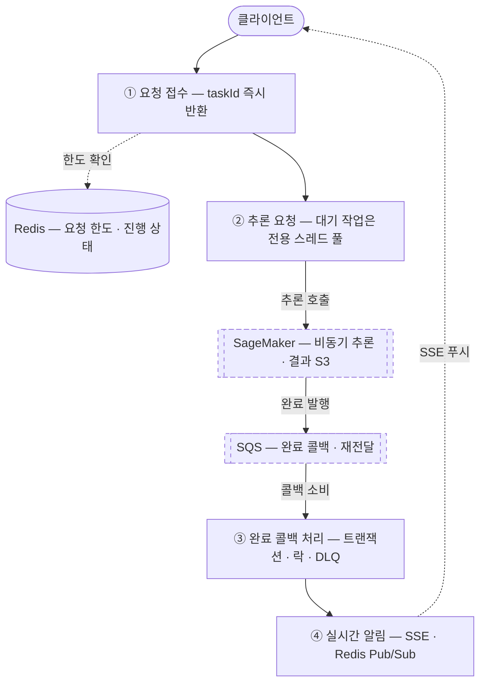

### 외부 연동 구간의 동시성·장애 문제를 다루는 백엔드 개발자

재현 테스트로 원인을 확인하고, 부하 측정으로 개선을 증명합니다.

 

## 실측으로 확인한 결과

| [**99%**](https://github.com/Aetheria-Tech/Aetheria-Service/blob/master/docs/benchmark/01-thread-occupancy.md) | [**2.5×**](https://github.com/Aetheria-Tech/Aetheria-Service/blob/master/docs/benchmark/01b-thread-occupancy-scale.md) | [**100%**](https://github.com/Aetheria-Tech/Aetheria-Service/blob/master/docs/benchmark/02-sqs-idempotency-consistency.md) | [**394×**](https://github.com/Aetheria-Tech/Aetheria-Service/blob/master/docs/troubleshooting/13-running-art-query-indexes.md) |
| :---: | :---: | :---: | :---: |
| 톰캣 워커 점유 감소 p95 101 → 1 · 동시 100 | 처리량 증가 398.6 → 993.7 TPS · 동시 500 · 10분 | SQS 중복 콜백 정합성 20건 × 5회 중복 · 3회 반복 | 목록 조회 단축 21 → 0.053ms · 51.8만 건 |

JMeter · WireMock · Actuator로 측정했습니다. 외부 응답 지연 500ms · 톰캣 워커 200 · 로컬 단일 호스트 기준이며, 수치를 누르면 측정 조건과 원자료가 있는 문서로 이동합니다.

 

## Aetheria — AI 러닝 아트 생성 서비스

> 주소·모양·숙련도만 넣으면, AI가 실제로 달릴 수 있는 러닝 코스를 그 모양대로 그려 줍니다.

**3인 팀 · 백엔드 전체 설계·구현 · 2025.06 – 2026.07 · 대학생 논문경진대회 금상** 
`Java 17` `Spring Boot 3.5` `WebClient` `MySQL 8` `Redis` `SQS` `SageMaker` `ECS Fargate` `AWS CDK`

AI 추론은 수 분이 걸리고, 실패할 수 있고, 호출마다 비용이 듭니다.
요청은 `taskId`로 즉시 돌려주고, 추론은 SageMaker 비동기 호출과 SQS 완료 콜백으로 분리했습니다.
외부 연동이 WebClient 이벤트 루프 하나를 함께 쓰기 때문에, 대기 작업은 전용 스레드 풀로 옮겨 한 곳이 느려져도 로그인까지 멈추지 않게 했습니다.

### 트러블슈팅

| 문제 | 해결 | 결과 |
| --- | --- | --- |
| **동시성** Redis·DB·S3 대기 작업이 외부 연동 이벤트 루프에 섞여, 하나가 느려지면 전부 멈출 수 있음 [문서](https://github.com/Aetheria-Tech/Aetheria-Service/blob/master/docs/troubleshooting/01-reactive-blocking-io.md) · [코드](https://github.com/Aetheria-Tech/Aetheria-Service/blob/master/src/main/java/com/serverbe/application/service/AiGenerationService.java) | 대기 작업을 `boundedElastic` 전용 풀로 이동 | 톰캣 워커 점유 **99%↓** |
| **장애 대응** 토큰 검증이 모두 Redis 블랙리스트를 거쳐, Redis가 죽으면 정상 토큰도 차단 [문서](https://github.com/Aetheria-Tech/Aetheria-Service/blob/master/docs/troubleshooting/06-refresh-token-rotation.md) · [코드](https://github.com/Aetheria-Tech/Aetheria-Service/blob/master/src/main/java/com/serverbe/adapter/out/persistence/token/TokenBlacklistAdapter.java) | 연결 실패·타임아웃만 검증을 건너뛰는 Fail-Open + 감사 로그 | Redis 장애에도 로그인 유지 위험은 토큰 15분 수명으로 제한 |
| **정합성** SQS가 같은 콜백을 중복·역순으로 전달 [문서](https://github.com/Aetheria-Tech/Aetheria-Service/blob/master/docs/troubleshooting/03-sqs-callback-race-condition.md) · [코드](https://github.com/Aetheria-Tech/Aetheria-Service/blob/master/src/main/java/com/serverbe/adapter/in/messaging/AiNotificationSqsListener.java) | 트랜잭션 + 락, 저장 전이면 예외로 재전달 유도, 계속 실패하면 DLQ | 정합성 **100%** Testcontainers 재현 |
| **비용 제어** 버튼을 연달아 누르면 SageMaker 비용도 그대로 발생 [문서](https://github.com/Aetheria-Tech/Aetheria-Service/blob/master/docs/troubleshooting/05-rate-limit-lua-token-bucket.md) · [테스트](https://github.com/Aetheria-Tech/Aetheria-Service/blob/master/src/test/java/com/serverbe/RateLimiterServiceConcurrencyTest.java) | 확인·차감을 묶은 Lua 토큰 버킷 (10회, 초당 5회 회복) | 한도 초과 **0건** |
| **세션 관리** 여러 기기로 로그인하면 세션이 계속 쌓임 [문서](https://github.com/Aetheria-Tech/Aetheria-Service/blob/master/docs/troubleshooting/14-multi-device-session-lru.md) · [테스트](https://github.com/Aetheria-Tech/Aetheria-Service/blob/master/src/test/java/com/serverbe/adapter/out/persistence/token/RefreshTokenSessionAdapterTest.java) | 등록·초과 확인·축출을 Lua 하나로 묶어 최대 3대 | 동시 로그인에도 목록·토큰 일치 |
| **DB 조회** 20건을 보여 주려 35,380건을 정렬, 위치 적재는 풀스캔 [문서](https://github.com/Aetheria-Tech/Aetheria-Service/blob/master/docs/troubleshooting/13-running-art-query-indexes.md) · [마이그레이션](https://github.com/Aetheria-Tech/Aetheria-Service/blob/master/src/main/resources/db/migration/V6__add_running_art_query_indexes.sql) | `EXPLAIN`으로 확인 후 복합·커버링 인덱스 2개 추가 | 목록 **21 → 0.053ms** 적재 **482 → 74.6ms** 쓰기 +17% 감수 |

<b>기술 선택과 감수한 점</b>

 

처리 속도보다 **서비스가 멈추지 않는 것**과 **데이터가 틀어지지 않는 것**을 먼저 지켰습니다.

| 결정 | 고른 것 | 대안 | 고른 이유 | 감수한 점 |
| --- | --- | --- | --- | --- |
| 외부 API 호출 | 서블릿 + WebClient | 동기 RestTemplate | 스레드 고갈 차단 (점유 176 → 65개) | 처리 시간 증가 (597 → 1,505ms) |
| 원자 연산 | Redis Lua 스크립트 | 자바 코드에서 명령 순차 실행 | 조회·계산·저장 사이의 경합을 Redis 안에서 한 번에 실행 | 스크립트 관리 포인트 증가 |
| 스키마 변경 | Flyway 마이그레이션 | Hibernate 자동 스키마 관리 | 제약 조건과 기존 데이터 정리까지 순서대로 관리 | 마이그레이션 파일 직접 관리 |

→ 전체 코드와 설계·측정 기록: **[Aetheria-Tech/Aetheria-Service](https://github.com/Aetheria-Tech/Aetheria-Service)**

 

## 그 외 프로젝트

| 프로젝트 | 한 일 | 기술 |
| --- | --- | --- |
| **[Coding Mate](https://github.com/Duskafka/Coding-Mate)** 개인 · 2025.04 – 2025.07 백준 풀이 기록·공유 서비스 | 기획부터 배포 자동화까지 단독 개발 · 일간 랭킹을 Spring Batch로 매일 정오에 집계해 Redis에 캐싱 · GitHub Actions로 빌드·테스트, Docker 이미지 배포, EC2 반영까지 자동화 · 계정당 무제한으로 쌓이던 Refresh Token을 Redis 카운트로 개수 제한 | Spring Batch Redis · Docker GitHub Actions |
| **[CodeForCode](https://github.com/Duskafka/code-for-code)** 팀 3명 · 2024.09 – 2024.11 AI가 문제를 출제하는 코딩테스트 학습 서비스 | 인증·게시판 API와 AI 연동 담당 · Gemini API로 사용자 조건에 맞춘 문제 자동 출제 · 마크다운 구조 JSON을 받는 프롬프트로 프론트엔드 렌더링 처리 최소화 · JPA Converter 재호출로 생긴 비밀번호 이중 암호화를 인코딩 지점 정리로 해결 | Spring Security JWT · MySQL Gemini API |

 

## 기술 스택

| 분야 | 기술 |
| --- | --- |
| **Backend** | Java 17 · Spring Boot 3.5 · Spring MVC · WebClient (Reactor) · Spring Security · JPA · Querydsl |
| **Data** | MySQL 8 · Redis (Lua · GEO · Pub/Sub) · Flyway |
| **Infra** | AWS ECS Fargate · RDS · S3 · SQS · SageMaker · AWS CDK · GitHub Actions |
| **Test** | JUnit 5 · Mockito · Testcontainers · MockWebServer · JMeter |

 

## 최근 글

동시성·스레드·커넥션 풀을 공부하며 정리합니다. → [velog 전체 보기](https://velog.io/@duskafka)

<ol>
<!-- BLOG-POST-LIST:START --><li><a href='https://velog.io/@duskafka/%EB%82%98%EC%9D%98-%EB%A6%AC%ED%8C%A9%ED%86%A0%EB%A7%81-%EC%9D%B8%EC%82%AC%EC%9D%B4%ED%8A%B8' style='color: #DDE6ED; text-decoration: none;'>📖 나의 리팩토링 인사이트</a> (2026-08-28)</li><li><a href='https://velog.io/@duskafka/%EB%8F%99%EC%8B%9C%EC%84%B1%EA%B3%BC-%EB%B3%91%EB%A0%AC%EC%84%B1' style='color: #DDE6ED; text-decoration: none;'>📖 동시성과 병렬성</a> (2026-07-17)</li><li><a href='https://velog.io/@duskafka/%EC%9E%90%EB%B0%94-21%EC%9D%98-%EA%B0%80%EC%83%81-%EC%8A%A4%EB%A0%88%EB%93%9C%EB%A5%BC-%EC%95%8C%EC%95%84%EC%95%BC-%ED%95%98%EB%8A%94-%EC%9D%B4%EC%9C%A0' style='color: #DDE6ED; text-decoration: none;'>📖 자바 21의 가상 스레드를 알아야 하는 이유</a> (2026-07-10)</li><li><a href='https://velog.io/@duskafka/%EA%B0%80%EC%83%81-%EC%8A%A4%EB%A0%88%EB%93%9C-%EC%A0%9C%EC%96%B4%EC%9D%98-%ED%95%B5%EC%8B%AC-Semaphore' style='color: #DDE6ED; text-decoration: none;'>📖 가상 스레드 제어의 핵심: Semaphore</a> (2026-07-08)</li><li><a href='https://velog.io/@duskafka/HikariCP-%ED%92%80%EC%9D%98-%ED%81%AC%EA%B8%B0%EB%A5%BC-%EB%AC%B4%EC%A1%B0%EA%B1%B4-%EB%8A%98%EB%A6%AC%EB%A9%B4-%EC%95%88-%EB%90%98%EB%8A%94-%EC%9D%B4%EC%9C%A0%EC%99%80-%EC%A0%81%EC%A0%88%ED%95%9C-%ED%8A%9C%EB%8B%9D-%EA%B3%B5%EC%8B%9D' style='color: #DDE6ED; text-decoration: none;'>📖 HikariCP: 풀의 크기를 무조건 늘리면 안 되는 이유와 적절한 튜닝 공식</a> (2026-07-08)</li><li><a href='https://velog.io/@duskafka/HikariCP%EC%99%80-DB-%EC%BB%A4%EB%84%A5%EC%85%98-%ED%92%80-%EC%99%9C-%EC%82%AC%EC%9A%A9%ED%95%A0%EA%B9%8C' style='color: #DDE6ED; text-decoration: none;'>📖 HikariCP와 DB 커넥션 풀: 왜 사용할까?</a> (2026-07-08)</li><li><a href='https://velog.io/@duskafka/%EA%B5%AC%EC%A1%B0%EC%A0%81-%EB%8F%99%EC%8B%9C%EC%84%B1Structed-Concurrency' style='color: #DDE6ED; text-decoration: none;'>📖 구조적 동시성&lpar;Structed Concurrency&rpar;</a> (2026-07-08)</li><li><a href='https://velog.io/@duskafka/ScopedValue-%EA%B0%80%EC%83%81-%EC%8A%A4%EB%A0%88%EB%93%9C%EC%97%90%EC%84%9C-%EC%82%AC%EC%9A%A9%ED%95%98%EB%8A%94-%EB%B3%B4%EA%B4%80%ED%95%A8' style='color: #DDE6ED; text-decoration: none;'>📖 ScopedValue: 가상 스레드에서 사용하는 보관함</a> (2026-07-07)</li><li><a href='https://velog.io/@duskafka/Filter%EC%99%80-Interceptor%EC%97%90%EC%84%9C-ThreadLocal%EC%9D%84-%EB%8B%A4%EB%A3%A8%EB%8A%94-%EB%B0%A9%EB%B2%95' style='color: #DDE6ED; text-decoration: none;'>📖 Filter와 Interceptor에서 ThreadLocal을 다루는 방법</a> (2026-07-07)</li><li><a href='https://velog.io/@duskafka/%EC%8A%A4%EB%A0%88%EB%93%9C%EC%97%90-%EB%8D%B0%EC%9D%B4%ED%84%B0%EB%A5%BC-%EC%A0%80%EC%9E%A5%ED%95%98%EB%8A%94-ThreadLocal' style='color: #DDE6ED; text-decoration: none;'>📖 스레드에 데이터를 저장하는 ThreadLocal</a> (2026-07-05)</li><!-- BLOG-POST-LIST:END -->
</ol>

 

## 수상 · 활동

| 시기 | 내용 | 결과 |
| --- | --- | :---: |
| 2026.07 | **한국디지털콘텐츠학회 하계종합학술대회 대학생 논문경진대회** "AI 기반 사용자 맞춤형 러닝 경로 아트 생성 웹 서비스" · Aetheria를 발전시킨 논문 · 공동저자 | 금상 |
| 2025.09 – 2025.12 | **2025 새싹 해커톤** Aetheria로 참가 · 팀 3명 | 참가 |
| 2022.11 | **한신대학교 컴퓨터공학부 소프트웨어공모전** 헌혈 주기 관리 앱 "오늘의 헌혈" · Android · 팀 2명 | 동상 |
| 2022.09 – 2023.01 | **백엔드 스터디** 현직 개발자 포함 3명 · TDD·DDD·RDD와 MVC·헥사고날 아키텍처 비교, 매주 주제 발표 | 스터디 |
| 2022.08 – 2022.11 | **자바 웹 스터디** 『객체지향의 사실과 오해』·『오브젝트』로 책임 주도 설계 학습, JVM·RDBMS 발제 | 스터디 |
| 2021.12 | **한신대학교 소프트웨어 공모전** C언어 슈팅 게임 · 팀 3명 · 동적 할당 기반 객체 관리와 이동 로직 구현 | 금상 |

 

**근본 원인을 끝까지 추적하고, 실측으로 증명하는 백엔드 개발자가 되겠습니다.**

[rlarlgus0206@naver.com](mailto:rlarlgus0206@naver.com) · [velog.io/@duskafka](https://velog.io/@duskafka) · [github.com/Duskafka](https://github.com/Duskafka)

